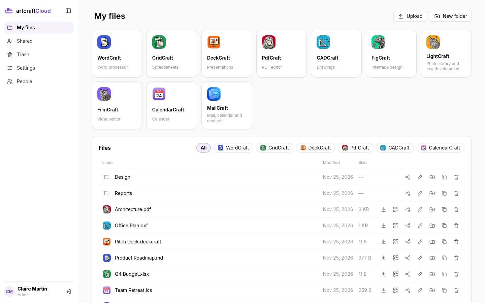
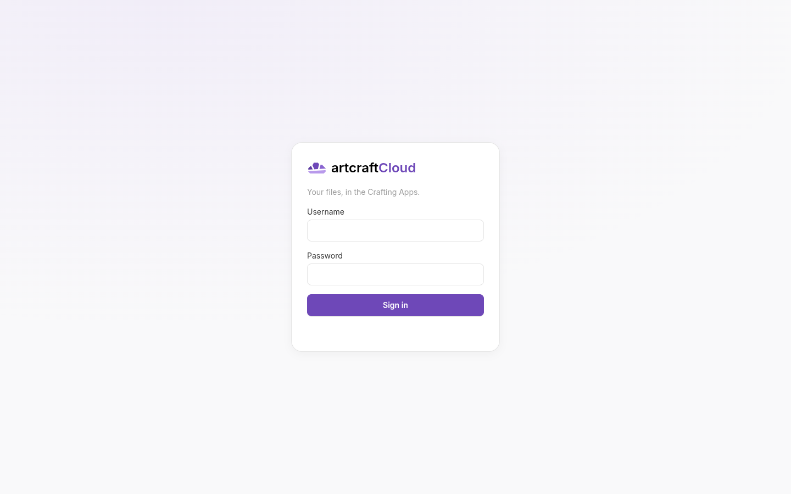
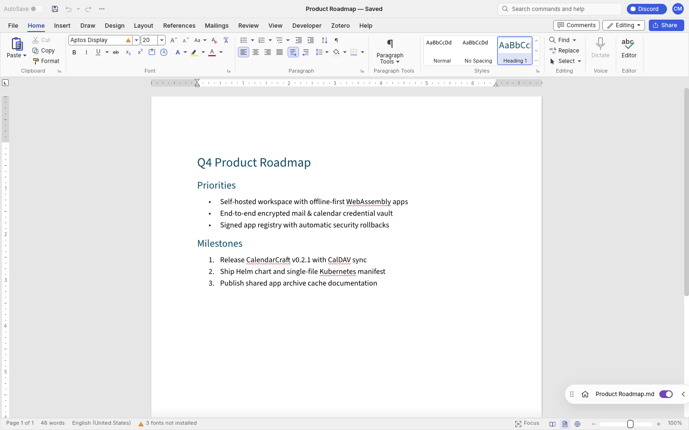
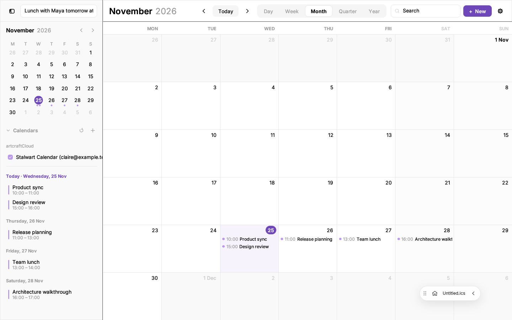
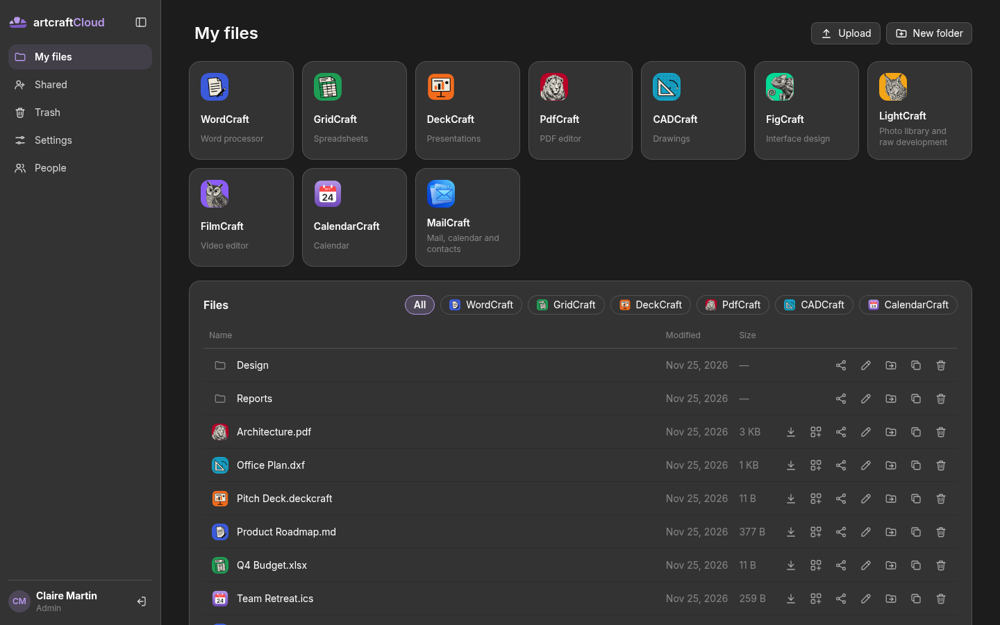
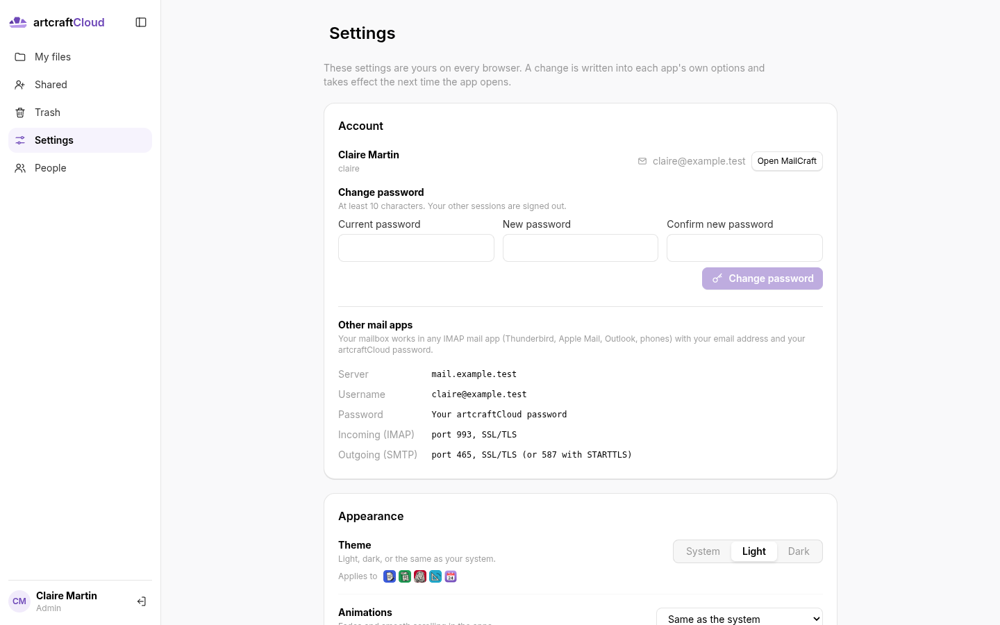
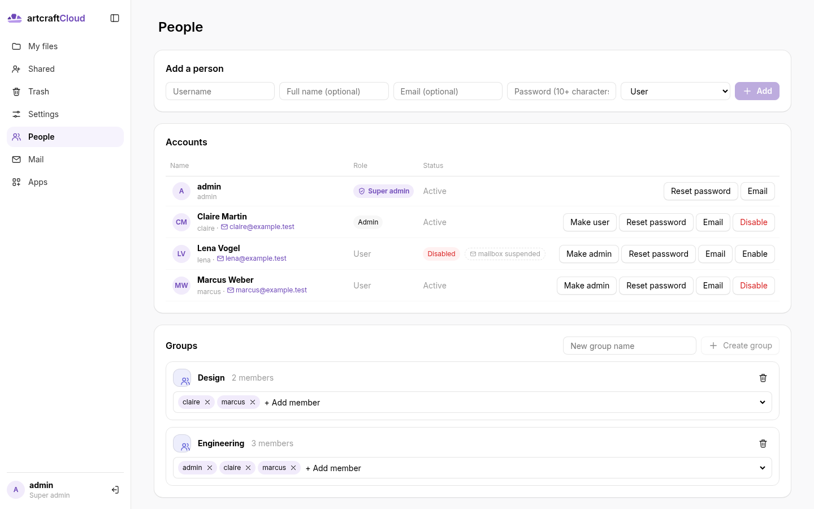
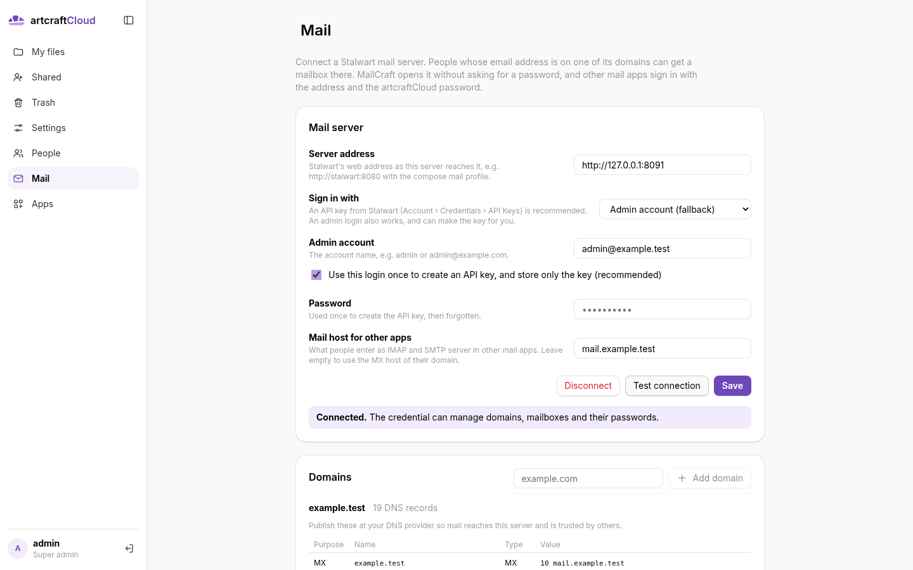
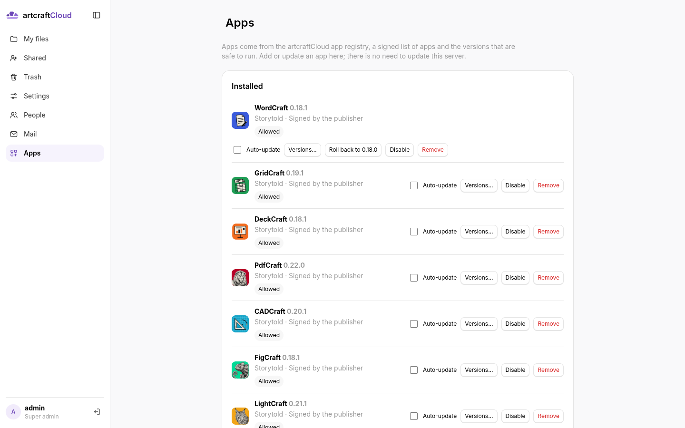

# artcraftCloud

A self-hosted office suite made only of the [ArtCraft Crafting Apps](https://getartcraft.com/apps)
(Rust compiled to WebAssembly, by [storytold](https://github.com/storytold)). Every user keeps their
files in their own folder on your server; WordCraft, GridCraft, DeckCraft and the other apps open and
save straight into it.



- **One Rust binary** (axum + SQLite), files stored as plain folders on disk, about **8–12 MB of RAM** idle.
- **A drive in Rust/wasm** (Leptos, no JavaScript framework): folders, upload, download, rename,
  move, copy, trash, sharing, and an app launcher.
- **Multi-user**: argon2id passwords, cookie sessions, admins who create and disable accounts, and one
  super admin who alone makes or removes admins.
- **Sharing**: with other users or groups (view or edit), a *Shared* view, and public links (view or
  edit, optional password and expiry).
- **Apps full screen** at their own address (`/open/Reports/q3.xlsx`), with a back arrow to the drive,
  and app options (author name, initials…) kept per user on the server.
- **WebDAV** at `/dav/` for desktop clients and, later, the apps' own cloud pages.
- **Safe saves**: every write carries an ETag. If someone else changed the file meanwhile, the
  shell keeps theirs and offers *Save a copy* for yours.
- **App updates** from a signed trust list (`registry/apps.json`, ed25519), with SHA-256 and publisher
  signature checks (OpenPGP or ed25519), automatic security rollbacks, atomic switch-over and one-step
  rollback.
- **Optional mail and calendar** with Stalwart (`v1.2.0`): MailCraft over a JMAP proxy, CalendarCraft
  over a CalDAV proxy (plus `.ics` files and sealed remote calendar accounts), and standard
  IMAP/SMTP/CalDAV for other apps.
- Runs as **one container** (Docker / Podman), with **Compose**, a **Helm chart** or **one
  Kubernetes manifest**.

## Quick start

```sh
docker run -d --name artcraft-cloud -p 8080:8080 -v artcraft-data:/data \
  -v artcraft-app-cache:/cache -e ARTCRAFT_APP_CACHE=/cache ghcr.io/gheiler/artcraft-cloud:latest
docker logs artcraft-cloud | grep -A2 "admin password"     # the generated admin password, shown once
```

Open <http://localhost:8080>. The first start downloads the ten default apps (about 210 MB of archives) into the volume
in the background; they show up in the launcher as each one finishes. The archives stay in the
`artcraft-app-cache` volume, so a new data volume installs them from there (checksums still
checked) instead of downloading them again; see [docs/build.md](docs/build.md).

> Anywhere but localhost, put it behind HTTPS (a reverse proxy or the Ingress below) and set
> `ARTCRAFT_PUBLIC_URL=https://…`. The apps need a secure context for WebGPU and the clipboard.

The image is published by CI from `main`. To build it yourself: `docker build -t artcraft-cloud .`
(a rebuild after a code change takes about 40 s; [docs/build.md](docs/build.md)).

### Docker Compose

```sh
ARTCRAFT_ADMIN_PASSWORD='choose-a-long-one' docker compose up -d
docker compose --profile mail up -d       # optional Stalwart mail server, read docs/mail.md first
```

### Kubernetes, one file

```sh
kubectl apply -f https://raw.githubusercontent.com/gheiler/artcraft-cloud/main/deploy/kubernetes/artcraft-cloud.yaml
kubectl -n artcraft-cloud logs deploy/artcraft-cloud | grep -A2 "admin password"
kubectl -n artcraft-cloud port-forward svc/artcraft-cloud 8080:80
```

Uncomment the Ingress at the bottom of the file and set your host for HTTPS.

### Helm

```sh
helm install office ./deploy/helm/artcraft-cloud \
  --set publicUrl=https://office.example.com \
  --set ingress.enabled=true --set ingress.host=office.example.com \
  --set ingress.annotations."cert-manager\.io/cluster-issuer"=letsencrypt
```

One replica with `Recreate` (SQLite has one writer), a 10 Gi PVC, startup/liveness/readiness probes on
`/healthz` and `/readyz`, non-root, read-only root filesystem. See `deploy/helm/artcraft-cloud/values.yaml`.

## Apps

| App | Opens | Release tested | Status |
|-----|-------|----------------|--------|
| WordCraft | docx, odt, rtf, txt, md | 0.18.1 | open, edit, save, conflict copy: tested end to end |
| GridCraft | xlsx | 0.19.1 | new, Save As, reopen: tested |
| DeckCraft | pptx, potx, ppsx, deckcraft | 0.18.1 | new, Save As: tested |
| PdfCraft | pdf | 0.22.0 | open, save: tested |
| CADCraft | dxf | 0.20.1 | open, save: tested |
| FilmCraft | fcproj | 0.20.1 | new, Save As: tested |
| FigCraft | figcraft, fig | 0.18.1 | handshake tested |
| LightCraft | jpg, png, webp, gif, bmp, tif, dng | 0.21.1 | handshake and open tested |
| CalendarCraft | ics, ical, ifb | 0.2.1 | the person's Stalwart calendar over CalDAV, `.ics` files, feeds: tested against Stalwart |
| MailCraft | (mail) | 0.15.0 | opens the signed-in person's mailbox through the JMAP proxy: tested against Stalwart |

MailCraft (from [UCS-Care-Group/mailcraft](https://github.com/UCS-Care-Group/mailcraft)) has no host
bridge, so it opens no documents; it is installed like the others (its `SHA256SUMS.txt` is checked
against MailCraft's ed25519 release key) and opens from its card or *Settings › Account*. See
[docs/mail.md](docs/mail.md).

CalendarCraft (from [gheiler/calendarcraft](https://github.com/gheiler/calendarcraft)) opens the
signed-in person's calendar on the mail server through `/caldav/`, `.ics` files from the drive, and
other calendar accounts and feeds through `/api/calendar/remote` (passwords for remote accounts are
sealed in the server vault, never kept in plain text in the browser). See
[docs/calendar.md](docs/calendar.md).

PhotoCraft, VectorCraft, DesignCraft and the other Crafting Apps are not included yet: their web
builds do not speak the host bridge. `docs/upstream-gaps.md` lists what is missing upstream, with the
existing issues and pull requests.

## Screenshots

| Sign in | WordCraft |
|---|---|
|  |  |

| CalendarCraft | Dark theme |
|---|---|
|  |  |

| Settings | People |
|---|---|
|  |  |

| Mail | Apps |
|---|---|
|  |  |

## Using it

- **Roles.** The first admin account is the *super admin* (an existing install marks its oldest admin).
  Admins create users, reset passwords and disable or enable users. Only the super admin creates admins,
  turns users into admins and back, or touches another admin's account; the server enforces it
  (`403` otherwise), and the super admin cannot be disabled.
- **Passwords.** Everyone changes their own under *Settings › Account* (current password, new one twice;
  at least 10 characters). It signs out their other sessions. Admins can still reset someone's password
  from *People*.
- **Mail.** The super admin connects a Stalwart server under *Mail* (`/mail`) and adds domains there,
  with the DNS records each needs. Admins give people an email address in *People*; when its domain is
  on the server, artcraftCloud creates the mailbox and MailCraft opens it without a password. The
  mailbox password is the person's artcraftCloud password (kept in step on every change), so other
  mail apps work too; *Settings › Account* shows the IMAP/SMTP settings. Disabling a person suspends
  their mailbox (People shows it), and enabling them restores it. Stalwart is pinned
  (v1.2.0). Details, upgrades, and what disabling or deleting does, in [docs/mail.md](docs/mail.md).
- **Groups** are managed under *People* by admins. Sharing with a group gives every member access; a
  member who leaves loses it.
- **Addresses.** `/files/<folder>` is a folder, `/open/<path>?app=<app>` a document, `/new/<app>` a new
  one (it moves to `/open/…` after the first save), `/shared`, `/trash`, `/people`, `/mail`, `/admin/apps`, `/settings`, `/s/<token>` a
  public link. Opened from the drive, a document has a bar with a back arrow; opened from a link, it
  gets a small home button you can drag and fold away.
- **Autosave.** On by default (switch in *Settings* for every app, and in the document bar per app,
  remembered per user): the shell asks the app to save a few seconds after a change.
- **Options.** Each app's own options (WordCraft's author and initials, view settings…) are stored per
  user in `/api/settings/<app>` and restored before the app loads, so they follow you between browsers.
- **Open from inside the apps.** *File ▸ Open*, *Insert ▸ Picture* and similar show a picker over your
  drive (or *From this device…*). Documents open through the drive, so they save back to it.
- **LightCraft backups.** A `.zip` that is a LightCraft library backup gets the LightCraft icon and opens
  LightCraft, whose *Restore Library from Backup…* then offers it first. Any file can also be opened
  with another app via *Open with*.

## Settings

*Settings* (sidebar, `/settings`) holds what all the Crafting Apps have in common. It is stored per user
on the server (`GET`/`PUT /api/preferences`), so it follows you between browsers.

- **Theme**: System, Light or Dark. The shell switches at once (SnowUI-Dark tokens from the SnowUI
  Figma file's dark mode; *System* follows `prefers-color-scheme`).
- **Interface language**: *Same as the browser* or one of 44 languages, the union of what the apps
  ship (WordCraft 29, PdfCraft 36, GridCraft 19, CADCraft 19, LightCraft 18, CalendarCraft 6). Each app only gets a
  language it has; the page shows which. The shell itself is translated into **English, German,
  Spanish, French, Italian and Brazilian Portuguese** (`crates/shell/locales/*.tsv`, English source
  text as the key, English fallback); for another language it shows English. A change reloads the page.
- **Name and initials** for comments, tracked changes and document properties (empty = your account
  name and its initials).
- **Measurement units**: each app's default, inches, centimeters, millimeters or points.
- **Animations**: same as the system, on or off.
- **Autosave**: on or off for every app (the document bar can still turn it off for one app).

**How a change reaches the apps.** On `PUT /api/preferences` the server writes the changed settings
into every app's stored options (`/api/settings/<app>`, the same per-user copy of the app's
`localStorage` the shell restores before an app loads), keeping everything else the app stored. So it
applies the next time each app opens, also for apps never opened yet. Only changed settings are
written, so an option changed later inside an app stays until Settings changes again. When an app
starts and its options have no language (or a placeholder name such as *WordCraft User*), the shell
fills them from Settings first, so a first start is already in your language and under your name.

| Setting | WordCraft | GridCraft | PdfCraft | CADCraft | CalendarCraft | FigCraft | DeckCraft | LightCraft, FilmCraft |
|---|---|---|---|---|---|---|---|---|
| Theme | `wordcraft.ui` `theme` (system/light/dark) | `gridcraft.ui` `systemTheme` + `dark` | `pdfcraft` `theme` (System/Light/Dark) | `cadcraft.prefs` `theme` | `calendarcraft.ui` `theme` | – | – | – |
| Language | `wordcraft.ui` `language` | `gridcraft.ui` `language` (`zh`, `pt`…) | `pdfcraft` `language` | `cadcraft.prefs` `interfaceLanguage` (`pt-BR`, `zh`…) | `calendarcraft.ui` `language` | English only | English only | LightCraft: from the browser; FilmCraft: English only |
| Name | `wordcraft.ui` `author` | `gridcraft.prefs` `userName` | `pdfcraft` `author` | – | – | `figcraft.userName` | `?author=` at launch | – |
| Initials | `wordcraft.ui` `initials` | – | – (its initials are a signature image) | – | – | – | – | – |
| Units | `wordcraft.ui` `editing.measurementUnits` | – | `pdfcraft` `units` (`centimetres`…) | `cadcraft.profile` `sysvars.MEASUREINIT` (0 imperial, 1 metric; once the profile exists) | – | – | – | – |
| Animations | `wordcraft.ui` `animations` | `gridcraft.ui` `animations` (on/off only) | `pdfcraft` `animation_effects` | `cadcraft.prefs` `animations` | `calendarcraft.ui` `animations` | – | – | – |
| Autosave | shell | shell | shell | shell | shell | shell | shell | shell |

The mapping lives in `crates/types/src/prefs.rs` (`targets`); what cannot be mapped is listed in
[docs/upstream-gaps.md](docs/upstream-gaps.md) (gaps 11, 16–20).

## Adding and updating apps

Which apps exist, and which of their versions may run, comes from the **app registry**: a public,
signed list in this repository ([`registry/apps.json`](registry/apps.json), signature
`registry/apps.json.sig`). The server fetches it every 6 hours and on demand, checks its ed25519
signature against the keys built into the binary, refuses an older or expired copy, and keeps the
last good one in the data volume. New apps and new versions therefore reach a running server
without a new image. How the trust works, and how to add an app, a version or block one:
[docs/registry.md](docs/registry.md).

The super admin manages apps on **Apps** (`/admin/apps`): add an app from the registry, update to
the recommended version or pick another allowed one, roll back, disable or remove, and turn on
auto-update per app. A version the registry blocks is never installed; if one is installed already,
the super admin sees a warning on every page, and a security block rolls the app back to its
previous version (or disables it when there is none) on its own. The same from the command line:

```sh
docker exec artcraft-cloud artcraft-cloud apps list
docker exec artcraft-cloud artcraft-cloud apps update               # every installed app (and missing default ones)
docker exec artcraft-cloud artcraft-cloud apps update wordcraft --version 0.18.0
docker exec artcraft-cloud artcraft-cloud apps rollback wordcraft   # back to the version before
docker exec artcraft-cloud artcraft-cloud apps disable wordcraft    # enable, remove, auto-update on|off
docker exec artcraft-cloud artcraft-cloud apps registry refresh     # fetch the registry now
docker exec artcraft-cloud artcraft-cloud apps registry show        # what is in use: source, serial, expiry
docker exec artcraft-cloud artcraft-cloud apps install calendarcraft /data/calendarcraft-web-0.2.0.zip --version 0.2.0   # a local build
```

`scripts/update-apps.sh` wraps the same commands for the host (`ARTCRAFT_CONTAINER=artcraft-cloud` or
`ARTCRAFT_K8S=deploy/artcraft-cloud`), for example from cron. Every install downloads the version's
`<app>-web-<version>.zip`, checks its SHA-256 against the one the signed registry pins, verifies the
publisher's own signature over `SHA256SUMS.txt` with the release key the registry pins (OpenPGP via
gpg, or ed25519), checks the build contains the host bridge, unpacks into a staging folder,
precompresses it (brotli + gzip), renames it into place and only then switches
`apps/manifest.json`. The previous version stays on disk for rollback. Running servers pick up the
switch on the next request; no restart. No GitHub API calls are made, so no token is needed.

## Configuration

| Variable | Default | |
|----------|---------|---|
| `ARTCRAFT_DATA` | `/data` (image), `data` | Everything persistent: `db.sqlite`, `files/<user id>/`, `trash/`, `apps/`, `secret.key` |
| `ARTCRAFT_LISTEN` | `0.0.0.0:8080` | |
| `ARTCRAFT_PUBLIC_URL` | | `https://…` turns on Secure cookies (with `ARTCRAFT_COOKIE_SECURE=auto`) |
| `ARTCRAFT_ADMIN_USER` / `ARTCRAFT_ADMIN_PASSWORD` | `admin` / generated | Only used when the database has no users yet |
| `ARTCRAFT_COOKIE_SECURE` | `auto` | `1` / `0` to force |
| `ARTCRAFT_SESSION_HOURS` | `336` | |
| `ARTCRAFT_MAX_UPLOAD_MB` | `512` | |
| `ARTCRAFT_SKIP_APP_SYNC` | | `1` skips the first-start download of the default apps |
| `ARTCRAFT_REGISTRY_URL` | this repository's `registry/apps.json` on `main` | A mirror of the app registry; `<url>.sig` is fetched beside it ([docs/registry.md](docs/registry.md)) |
| `ARTCRAFT_REGISTRY_KEYS` | the built-in keys | Comma-separated ed25519 public keys (base64) for a registry you sign yourself; replaces the built-in keys |
| `ARTCRAFT_BLOCKED_APPS` | `security` | What to do with an installed version the registry blocks: `security` rolls back or disables it when the block is for security, `all` for every block, `warn` only warns |
| `ARTCRAFT_APP_CACHE` | `/cache` (compose) | A directory of downloaded app archives shared by data volumes; one whose SHA-256 matches the registry's checksum is installed from there instead of downloaded ([docs/build.md](docs/build.md)) |
| `ARTCRAFT_MAIL_URL` | | Stalwart address offered on the Mail page (`http://stalwart:8080` in compose); see [docs/mail.md](docs/mail.md) |
| `ARTCRAFT_CALENDAR_ALLOW_PRIVATE` | | `1` lets `/api/calendar/remote` reach private/loopback addresses in a local lab ([docs/calendar.md](docs/calendar.md)) |
| `ARTCRAFT_SHELL_DIR` | `/opt/artcraft-cloud/shell` (image) | The built drive UI |
| `ARTCRAFT_OIDC_ISSUER` | | Reserved: the server refuses to start while OIDC is not implemented, rather than fall back to passwords silently |

Accounts and mail from the command line: `artcraft-cloud user create --username ana --password '…' [--admin]`,
`artcraft-cloud user disable ana`, `artcraft-cloud user enable ana`, `artcraft-cloud mail connect --url http://stalwart:8080 --admin …`,
`artcraft-cloud mail test`. The command line acts as the host operator, so `--admin` works there without the super admin.

## Memory

Measured on Linux x86_64 with the release binary (23 Nov 2026):

| | RSS |
|---|---|
| Idle after start | **7.7 MB** |
| After a login | 8.1 MB |
| Peak under load: 200 downloads of the 61 MB WordCraft wasm (32 at a time), 30 uploads of 20 MB, 20 logins, a WordCraft open/edit/save in Chrome | 52 MB (argon2 takes 19 MiB per login in flight) |
| Settled after that load | 12 MB |
| In the container (rootless Podman, `--read-only`, 128 MB limit): idle | 7.8 MB |
| In the container: during the first-start download of all 8 apps | 11.4 MB (peak 26 MB) |
| In the container: after an end-to-end WordCraft open, edit and save | 8.6 MB (peak 28 MB) |

Image: about 100 MB (Debian slim + gpg + a 9 MB binary). The drive UI is a 1.5 MB wasm file (500 KB gzipped) plus 180 KB of icons and the Inter font.

The image sets `TOKIO_WORKER_THREADS=2`, `MALLOC_ARENA_MAX=2` and `MALLOC_MMAP_THRESHOLD_=131072`. Without
them the same binary idles at about 28 MB and holds about 48 MB after the first login, because glibc
keeps the argon2 buffer. The apps themselves are static files; their memory use is in the browser.

## Architecture

```
browser ── one origin ──────────────────────────────────────────────┐
  │  /               drive (Leptos → wasm)                           │
  │  /apps/<app>/    Crafting App web builds, iframed ?host=parent   │   artcraft-cloud (one process)
  │  /api/…          JSON API (cookie session + X-Requested-With)    │── axum ── SQLite (users, sessions, shares, trash)
  │  /dav/…          WebDAV (Basic auth)                             │        └─ data/files/<user>/…  plain files
  └──────────────────────────────────────────────────────────────────┘
```

Cargo workspace (a modular monolith, one binary):

- `crates/server`: HTTP API, sessions, permissions, file store, WebDAV, static app serving.
- `crates/cli`: the `artcraft-cloud` binary: `serve`, `healthcheck`, `apps`, `registry`, `user`, `mail`.
- `crates/shell`: the drive and the app host, compiled to wasm with trunk.
- `crates/types`: API types and the app catalog, shared by server and shell.

The shell is the parent side of `craft-web-host`: it waits for `<app>:ready`, answers `<app>:host`, sends
`<app>:open` with the bytes, stores each `<app>:save` with `If-Match`, asks for a name and folder when an
app sends a Save As or a new document, warns before leaving with unsaved changes (`<app>:dirty`), and
follows `<app>:handoff` to the right app. Apps and shell share one origin because the bridge only talks
to a same-origin parent.

## Security notes

- Passwords: argon2id (19 MiB, 2 passes). Logins are rate limited per user name (8 per 10 minutes, 20 for WebDAV).
- Sessions: random tokens, `HttpOnly`, `SameSite=Lax`, `Secure` behind HTTPS. API writes need the
  `X-Requested-With: artcraft` header (CSRF guard).
- Paths are resolved inside the user's home; `..`, absolute paths and symlinks out are rejected.
  App zips are checked for path traversal before unpacking.
- Public links are random 192-bit tokens, optionally with a password and an expiry.
- The apps run in same-origin iframes, so they are trusted code: updates come from the ed25519-signed
  app registry and check each archive's SHA-256 and pinned publisher release signature (OpenPGP or
  ed25519).
- The content security policy allows `wasm-unsafe-eval` and `unsafe-eval`, which the apps' wasm
  loaders need.
- Mail and calendar credentials: the Stalwart API key (or admin login), each mailbox's app password,
  and remote CalDAV passwords are sealed in the database (ChaCha20-Poly1305, key derived from
  `secret.key`) and never sent to a browser; a
  password change waiting for an unreachable mail server is sealed too and dropped once it lands.
  MailCraft reaches the mail server only through `/jmap/…` with 15-minute tokens; disabled people
  are refused, and their mailbox is suspended on the mail server (no app signs in or sends; mail
  still arrives). Changing
  your own password needs the current one, is rate limited (8 per 10 minutes) and ends your other
  sessions.

## Roadmap

- Single sign-on via OIDC (the seam is in `crates/server/src/oidc.rs`).
- More apps as their web builds gain the bridge (PhotoCraft, VectorCraft, DesignCraft…).
- Live collaboration once ArtCraft has it beyond FigCraft (`figcraft-server` could run beside us).
- WebDAV-backed Open/Save inside the apps, a real host file picker message, read-only sessions (see `docs/upstream-gaps.md`).
- S3-compatible storage, quotas, app passwords for WebDAV.

## Development

```sh
rustup target add wasm32-unknown-unknown        # and install trunk: https://trunkrs.dev
(cd crates/shell && trunk build --release)
ARTCRAFT_ADMIN_PASSWORD=dev-password-123 ARTCRAFT_COOKIE_SECURE=0 cargo run --release
cargo test --workspace
cargo clippy --workspace --all-targets -- -D warnings
cargo clippy -p artcraft-cloud-shell --target wasm32-unknown-unknown -- -D warnings
```

The look follows the SnowUI design system (colour, type, radius and spacing tokens taken from its Figma
file) with purple as the primary colour. The mark is a four-facet beveled cloud (light and dark
versions, plus a simplified 16px favicon) in [`assets/brand/`](assets/brand/). Browser checks: `tests/e2e/`.

## License

MIT OR Apache-2.0, at your option, like ArtCraft. Third-party assets are listed in `NOTICE`. The optional Stalwart container is AGPL-3.0 and runs
as a separate process; it is never linked into artcraftCloud.
